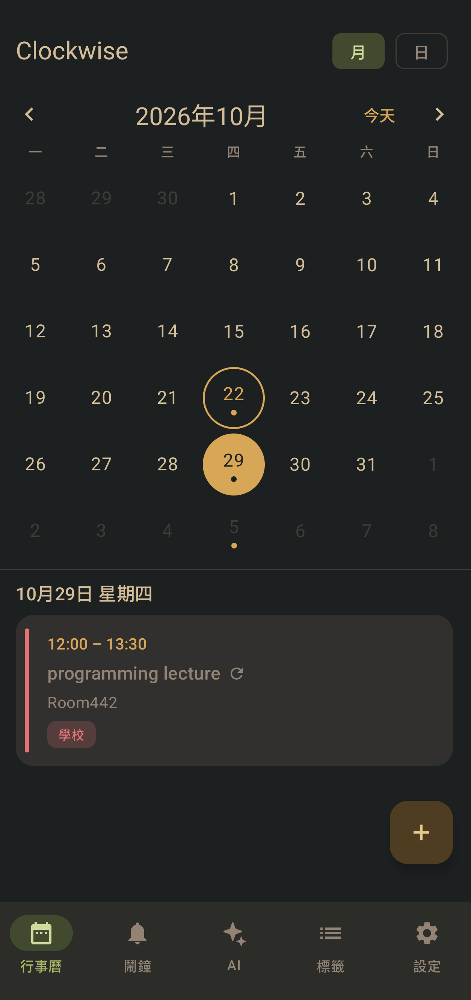
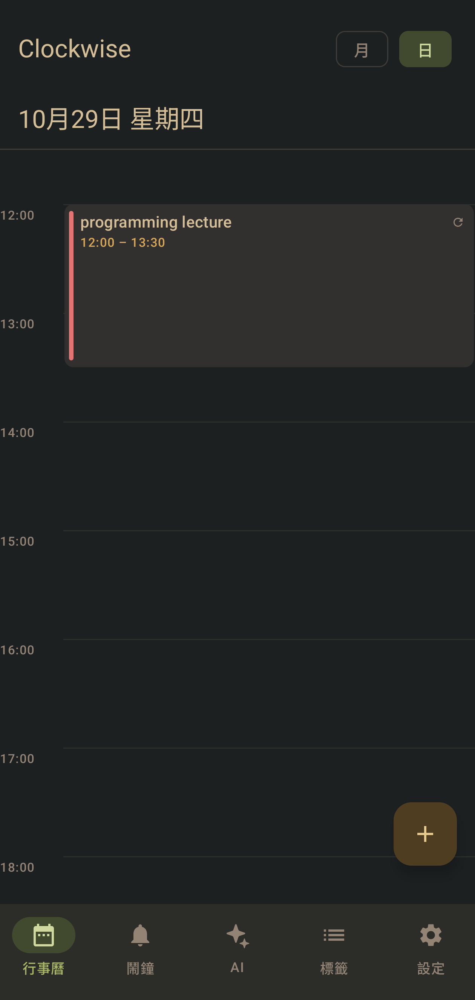
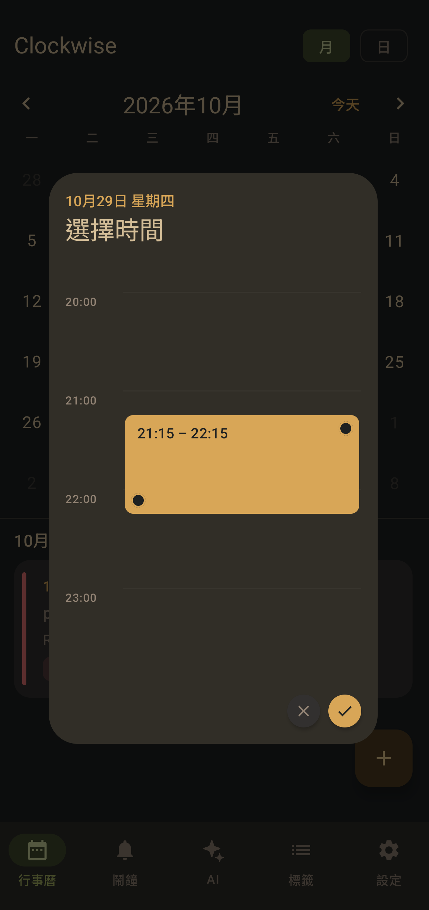
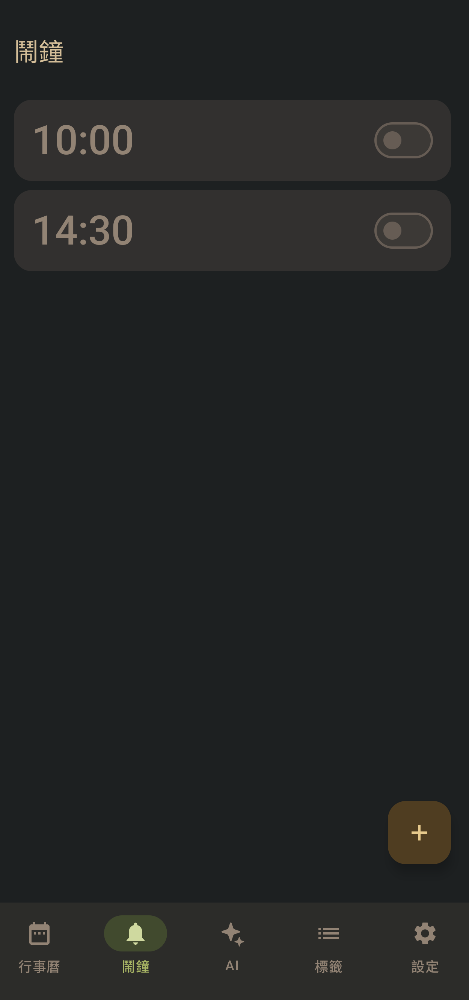
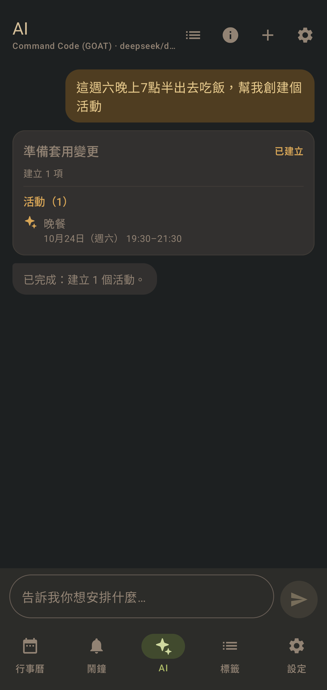

# Clockwise

[English original](README.md) | [繁體中文](README.zh-TW.md) | **简体中文**

Clockwise 是一款本地优先的 Android 日历与闹钟应用，使用 Jetpack Compose 和 Material 3 构建。
它结合了月/日视图、可全屏响铃的精确闹钟、彩色标签，以及可选的 AI 助手；AI 会在你确认预览后
读取并修改日程。

界面目前仅提供繁体中文（zh-TW），源代码和文档以英文为主。

## 界面预览

以下是主要界面的快速预览：

| 月视图 | 日视图 | 创建活动 |
| :---: | :---: | :---: |
|  |  |  |

| 闹钟 | AI 助手 |
| :---: | :---: |
|  |  |

## 功能

### 日历

- 月和日视图，每周从星期一开始。
- 创建、编辑、删除活动，包含标题、备注、开始/结束时间、标签和可选闹钟。
- 直接在日时间轴上创建活动；拖动草稿块微调开始和结束时间。时间会吸附到可配置的间隔
  （5–60 分钟，默认 15 分钟）。
- 重复活动：每天、每周指定星期几，或重复至指定结束日期。
- 可编辑或删除单个活动、此活动及所有后续活动，或整个系列。系列编辑会保留各活动的日期，
  仅同步共享字段。

### 闹钟

- 一次性闹钟，以及关联日历活动的闹钟。
- 通过 `AlarmManager` 安排精确闹钟，并在锁屏上显示全屏闹钟。
- 可在响铃界面停止或稍后提醒；稍后提醒默认 10 分钟。
- 可选的 10 秒测试闹钟，以及通知、精确闹钟、全屏 Intent 和电池优化设置的可靠性检查清单。
- 提供 vivo/OriginOS 后台限制的厂商专属指引。
- 重启或应用更新后，会重新安排已启用的闹钟。

### AI 助手

- 自备 **DeepSeek** 或 **Command Code (GOAT)** 的 API 密钥。两者均使用与 OpenAI 兼容的
  Chat Completions API。
- 助手可以列出闹钟和活动、创建/更新/删除两者、创建重复活动，并将闹钟附加到活动。
- 每次写入都会先显示受影响项目的预览；在你确认前不会更改任何内容。
- 对话记录界面保留最近三个对话；超过 24 小时未互动的对话会过期。用量面板显示输入、输出、
  缓存和推理 token。
- 支持获取模型列表、手动输入模型 ID、测试连接和选择推理强度。

### 个性化与数据

- 主题：跟随系统、浅色、深色和 Gruvbox Material。
- 滚轮或时钟时间选择器、可配置的时间轴吸附间隔，以及两种闹钟堆叠动画。
- 活动和闹钟共用彩色标签，每个项目有标签数量上限。
- 所有数据都存储在本地 Room 数据库。不涉及账号、分析或 Clockwise 后端。
- Room schema 会导出到 `app/schemas/`，以便审查和测试数据库迁移。

## 界面

| 标签页 | 用途 |
| --- | --- |
| 日历 | 月历网格、日时间轴、活动编辑器、重复范围 |
| 闹钟 | 闹钟列表、倒计时、编辑器、权限/可靠性检查 |
| AI | 对话、变更预览、已保存对话、token 用量 |
| 标签 | 创建和管理彩色标签 |
| 设置 | 主题、时间选择器、吸附间隔、闹钟动画、AI 配置 |

## 环境要求

- 支持 AGP 9.4 的 Android Studio，或命令行 Android SDK 环境
- JDK 17 或更高版本（项目目标为 Java 17）
- Android SDK Platform 37 及对应的 build tools
- 运行 Android 8.0（API 26）或更高版本的设备或模拟器

本应用不依赖 Google Play 服务。

## 构建

使用 Android Studio 打开仓库根目录并让 Gradle 同步。将 Gradle JDK 设置为 17 或更高版本。

从命令行：

```bash
export JAVA_HOME=/path/to/jdk-17-or-newer
export ANDROID_HOME=/path/to/Android/Sdk
export ANDROID_SDK_ROOT="$ANDROID_HOME"

./gradlew :app:assembleDebug
```

调试 APK 会输出到 `app/build/outputs/apk/debug/app-debug.apk`。

如果你更喜欢 `local.properties` 文件，可将它指向 SDK，而不用导出 `ANDROID_HOME`：

```properties
sdk.dir=/path/to/Android/Sdk
```

`local.properties` 已被有意加入 git 忽略。

## 运行

连接设备或模拟器后：

```bash
adb install -r app/build/outputs/apk/debug/app-debug.apk
adb shell am start -n com.dinoe.clockwise/.MainActivity
```

Release 构建类型目前未签名，且已禁用代码压缩，因此仅适合本地测试。

## 测试

JVM 单元测试覆盖 AI 工具解析器、提示/上下文构建、token 预算、模型目录、会话序列化，以及与
OpenAI 兼容的客户端（使用 MockWebServer）：

```bash
./gradlew :app:testDebugUnitTest
```

项目目前没有 instrumentation 测试。

## AI 设置

1. 打开 **设置 → AI 助手**。
2. 选择 DeepSeek 或 Command Code，粘贴 API 密钥。
3. 可选刷新模型列表，或手动输入模型 ID。
4. 使用 **测试连接** 验证密钥和模型。
5. 返回 AI 标签页开始对话。

AI 助手为可选功能。没有密钥时，应用的其他部分仍可正常使用。

### 隐私与安全

- API 密钥使用 Android Keystore 中的 AES-GCM 密钥加密后保存。Keystore 密钥无法导出，也不会
  通过 Android 备份恢复，因此恢复备份后会再次要求输入密钥。
- 对话文本、提示以及回答所需的日程上下文会直接发送给你选择的服务商。Clockwise 不会将数据
  发送到其他任何地方。
- 对话和用量数据存储在本地 Room 数据库，不会上传。
- 删除对话只会从本地数据库移除，不会删除服务商保留的内容。

## 权限

| 权限 | 用途 |
| --- | --- |
| `POST_NOTIFICATIONS` | 闹钟响铃通知；Android 13+ 需要运行时权限 |
| `SCHEDULE_EXACT_ALARM` | Android 12 及以下的精确闹钟调度 |
| `USE_EXACT_ALARM` | Android 13+ 的精确闹钟调度 |
| `USE_FULL_SCREEN_INTENT` | 锁屏上的全屏闹钟 |
| `RECEIVE_BOOT_COMPLETED` | 重启后恢复已启用的闹钟 |
| `WAKE_LOCK`、`VIBRATE` | 响铃时唤醒设备并振动 |
| `FOREGROUND_SERVICE`、`FOREGROUND_SERVICE_SPECIAL_USE` | 保持闹钟响铃服务运行 |
| `INTERNET` | 调用你配置的 AI 服务商 |

本应用不会请求位置、联系人权限，也不会访问系统日历提供程序。

## 项目结构

```
app/src/main/kotlin/com/dinoe/clockwise/
├── MainActivity.kt           # 单 Activity 宿主
├── ClockwiseApp.kt           # 应用组装：数据库、writer、repository
├── data/                     # Room 实体、DAO、重复规则、ScheduleWriter
├── alarm/                    # AlarmManager 调度、receiver、service、notifier
├── ai/                       # 服务商、客户端、提示、工具、解析、密钥存储
└── ui/                       # Compose 界面、view model、主题、选择器
```

- **`ScheduleWriter`** 是闹钟和活动的唯一写入路径，供界面和 AI 助手共用，确保 AI 创建的项目
  与手动创建的一致。
- **`AppDatabase`** 是 Room 数据库（目前 schema 版本 8）。导出的 schema 位于 `app/schemas/`；
  数据库变更时请一并提交新的 schema 文件。
- **`AlarmScheduler`** 负责精确/非精确调度的回退以及重启后的重新调度。
- **`AiTools` / `AiToolParser`** 定义并验证 function-calling 工具。写入工具只会生成提案；
  用户确认后才由 `ScheduleWriter` 执行。
- **`OpenAiChatClient`** 可与任何 OpenAI 兼容的 Chat Completions 端点通信。

## 贡献

欢迎提交 issue 和 pull request。在打开 PR 之前：

1. Kotlin 源代码、注释和 commit 信息请保持英文。
2. 运行 `./gradlew :app:testDebugUnitTest` 和 `./gradlew :app:assembleDebug`。
3. 如果修改数据库，请添加 Room schema 文件。
4. 请勿提交 API 密钥、签名密钥、`local.properties` 或构建产物。

## 已知限制

- 日历仅限本地；不会与 Google 日历、CalDAV 或系统日历提供程序同步。
- 界面目前仅提供繁体中文。
- 没有主屏幕小部件。
- AI 功能依赖外部服务商及其可用性、定价和数据政策。
